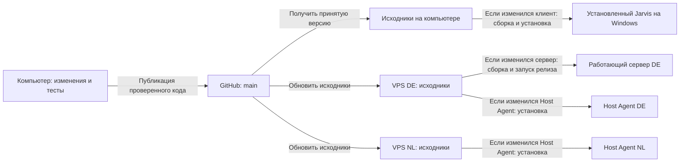
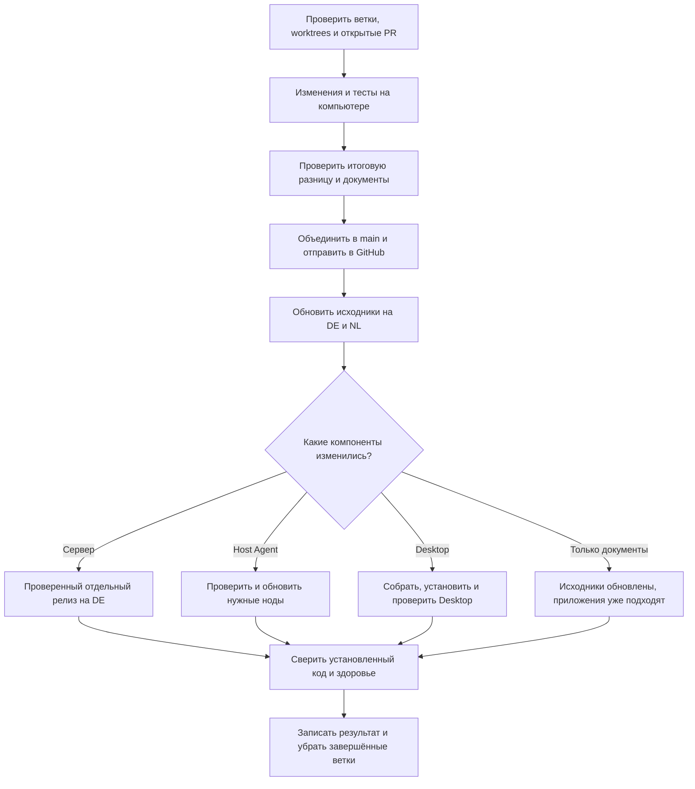

# Как выпускаем Jarvis

GitHub хранит принятую версию. На компьютере сначала проверяем изменения,
затем публикуем их в `main`. Оба VPS получают эту версию из GitHub. Работающий
сервер и установленный Desktop обновляются отдельным шагом, когда меняется их код.

## Как синхронизация работает сейчас

Обновление выполняет агент в рамках порученного выпуска. Постоянного фонового
обновления после каждого push нет. GitHub хранит общую принятую версию;
компьютер и два VPS получают исходники из неё.

GitHub `main` является источником истины для обоих VPS. Как только агент успешно
опубликовал согласованные изменения в эту ветку, он сразу продолжает обновление
обоих VPS без отдельного напоминания или повторного разрешения пользователя.
Это включает установку изменившихся VPS-компонентов и проверку результата.
Коммиты только на компьютере или в другой ветке ещё не являются выпуском для VPS.



Исходники являются файлами проекта. Работающее приложение использует свою
установленную копию. Поэтому получение файлов из GitHub и установка обновления
проверяются отдельно. Например, новая инструкция в MD попадёт на оба VPS,
а сервер продолжит работать: его код при этом не менялся.

1. Перед правками проверяем, не оставлена ли работа в других ветках, отдельных
   рабочих папках (worktrees), сохранённых правках (stash) или запросах на
   объединение (PR). Нужные изменения учитываем, чужую работу сохраняем.
2. Меняем и проверяем проект на компьютере. Затем публикуем принятую версию
   в общей ветке `main` на GitHub.
3. Получаем эту версию на обоих VPS. Если менялся код приложения, отдельно
   обновляем соответствующий сервер, Host Agent или Windows-клиент.
4. Сверяем файлы установленного кода и состояние служб. Результат выпуска
   записываем в `docs/updates/`; живые сценарии проверяем по затронутой функции.

## Где читать описание выпуска на GitHub

Главный [README](../README.md) содержит ссылку на это руководство. Здесь
находится текущий порядок работы и схемы. [Карта документации](README.md)
показывает состояние проекта, а датированные записи в `docs/updates/`
объясняют конкретные выпуски. Описание выпуска от 9 октября:
[единый порядок обновления](updates/2026-10-09-release-workflow.md).

Такая запись входит в историю Git вместе с изменениями. GitHub показывает
Mermaid-блоки как схемы. При выпуске новой версии приложения её отдельная
страница GitHub Releases может ссылаться на соответствующую запись.

## Порядок выпуска



## Что означает «всё одинаковое»

| Место | Что сверяем |
| --- | --- |
| GitHub | Принятый commit в `main` |
| Windows-исходники | Чистая `main` с тем же commit |
| DE и NL, исходники | `/home/deploy/apps/jarvis`, чистая `main` с тем же commit |
| Работающий сервер DE | Файлы внутри контейнера, зависимости и входные файлы сборки из принятой версии |
| Host Agent DE и NL | Установленные Python-модули совпадают с принятой версией |
| Установленный Desktop | Код, ресурсы, версия, зависимости и bundled wake-word runtime |

Полный SHA работающего server release может быть старше `main`, если позже
менялись только документы или другие компоненты. В таком случае сверяем
содержимое компонентов и входные файлы сборки. Записываем оба SHA и причину,
не объявляем релиз устаревшим только из-за новой записи в MD.

На Windows окончания строк могут отличаться от Git. Проверка Desktop сравнивает
текст с нормализованными окончаниями строк и бинарные ресурсы без преобразования.
Native Electron сверяется с locked версией: DLL/данные и PE-секции кода, отдельно
от ресурсов имени/иконки/версии, которые меняет упаковщик. Bundled Node сверяется
с входным файлом сборки. Недоступная проверка даёт незавершённый результат.
Одинаковый номер версии сам по себе не доказывает одинаковый код.

## Проверка перед работой и перед публикацией

Из корня проекта:

```powershell
py deploy/scripts/release-status.py --fetch
git worktree list
gh pr list --state open --json number,headRefName,baseRefName
```

Команда показывает все локальные и отслеживаемые ветки, сколько коммитов каждой
ещё нет в `main`, возраст последнего коммита и незаконченные изменения в
worktrees, а также количество сохранённых stash. Сохранённую работу в stash
тоже изучи и учти, не применяй и не удаляй её автоматически.
Команда ничего не сливает, не удаляет, не устанавливает и не перезапускает.
`--fetch` только получает свежие сведения с GitHub и удаляет устаревшие remote
tracking refs; реальные ветки, коммиты и рабочие файлы сохраняются.

Перед новой веткой изучи каждую существующую:

| Состояние | Действие |
| --- | --- |
| Полезные изменения относятся к задаче | Просмотри diff, включи проверенные изменения с сохранением истории и повтори нужные тесты |
| Идёт другая задача, есть PR или грязный worktree | Сохрани её, учти пересечения файлов, работай отдельно; не переключай и не меняй чужой checkout |
| Уникальные изменения непонятны | Изучи коммиты и владельца задачи. Запиши, что ветка сохранена; не сливай её автоматически |
| Все нужные коммиты уже в `main`, работа закончена | Убедись, что нет активного PR/worktree, затем удали завершённую ветку |
| Ветка долго не менялась | Возраст служит поводом проверить её статус. Он не разрешает удаление |

Если GitHub CLI недоступен, используй доступный GitHub API или интерфейс.
Если статус PR установить нельзя, удаление ветки откладывается. Squash-merge
требует отдельной проверки PR и эквивалентности изменений: простой ancestry-check
не доказывает, что уникальные коммиты можно выбросить.

Короткие ветки `codex/<задача>` разрешены после этой проверки. Не создавай
постоянные альтернативы `main` и цепочки веток поверх незавершённой работы.
В начале и конце задачи повтори инвентаризацию. Не удаляй чужую ветку ради
успешного source guard: проверка production source намеренно требует только
`main`. Если неучтённые refs мешают staging, сохрани работу и разберись с её
завершением; не используй force, reset или clean.

## Публикация на GitHub

1. Проверь изменения, нужные тесты и документы. Коммит должен описывать
   итоговый результат. Не включай чужие файлы, `.env`, local state и секреты.
2. Перед объединением снова получи `origin/main`. Если он изменился, сохрани
   текущую работу, объедини изменения без потери истории и повтори проверки.
3. Объедини короткую ветку в `main`. Отправь `main` обычным push, без force.
   Конфликтующий push означает, что `main` изменился: изучи новые коммиты.
4. Проверь чистоту и `HEAD...origin/main` = `0 0`. Удали свою завершённую
   ветку только после проверок PR/worktree и включения её полезных изменений.

## Обновление VPS

После успешной публикации согласованных изменений в GitHub `main` сразу
синхронизируй оба VPS и доведи изменившиеся VPS-компоненты до проверенного
результата. Это обязательное продолжение публикации; отдельный запрос
«обнови VPS» не нужен. При проверке уже опубликованной `main` устрани найденное
отставание VPS по тому же порядку. Если обновлению мешают конфликт, чужие
изменения, недоступный хост или неуспешная проверка, сохрани состояние и сообщи,
какой узел не обновлён. Не объявляй публикацию полностью завершённой.
Правило относится к принятому коду Jarvis, а обновление системных пакетов
остаётся отдельной задачей.

Для каждого хоста отдельно (`jarvis-vps` для DE, `jarvis-vps-new` для NL):

1. Проверь origin, ветку, dirty files и refs. Если source чистый и может
   продвинуться без конфликта, выполни `git pull --ff-only origin main`.
2. После pull, до staging, выполни:

   ```bash
   python3 deploy/scripts/verify-source-checkout.py source /home/deploy/apps/jarvis
   ```

3. Если есть локальные изменения, неверный origin, вложенный `jarvis/` или
   расхождение истории, останови только этот переход и сохрани состояние.
   Подготовь отдельный соседний checkout; не чини production через `reset --hard`.
4. Проверь, какие компоненты реально отличаются от установленной версии.
   Обновляй их по таблице ниже. Документы не требуют рестарта приложений.

Source guard сверяет source с текущим GitHub `main`. Поэтому отставший чистый
source сначала обновляется fast-forward; guard выполняется после pull и перед
upload/staging. Новый server release проверяется отдельно по записанному полному SHA.

| Компонент | Порядок установки и проверки |
| --- | --- |
| Server / Operations UI | Подготовь отдельный immutable release; проверь полный SHA и достижимость из GitHub `main`. Сверь окружение с работающим сервером без вывода значений, сохрани secret permissions. Выполни preflight, сборку и тесты образа; замени только server с `--no-deps`, проверь readiness/smoke и container IDs |
| Host Agent | Сначала Linux-тесты из полного source tree, включая соседние `deploy/vpn` fixtures. Используй `deploy/host-agent/deploy.sh` с проверенным source. После установки проверь health и совпадение модулей на нужном хосте |
| Desktop | При порученном обновлении Desktop или полном релизе с Desktop-изменениями: профильные тесты, `npm run dist:win`, установка, сравнение resources/app, проверка native modules и bundled Node/Vosk, запуск и нужный живой сценарий |
| Документы / skill / проверочный скрипт | Проверки ссылок, skill и скрипта; GitHub и оба source checkout. Работающие приложения оставь без рестарта, если их содержимое и входные файлы сборки совпадают |

Не заменяй `.env`, ключи, VPN state, токены подписок, пользовательские данные,
порты или bind mounts без необходимости задачи. До смены/удаления каталога
проверь Docker mounts; сохраняй оригинальные inode до пересоздания контейнеров.
Обновление Host Agent не требует перезапуска Xray/Hysteria2. Backup timer
остаётся отложенным. Расширенные операции: [deploy/README.md](../deploy/README.md).

## Одна команда для итоговой сверки

```powershell
py deploy/scripts/release-status.py --fetch --vps --desktop-app "C:/Program Files/Jarvis Desktop/resources/app" --check
```

Для другого пути установки передай его `resources/app`. Скрипт использует
настроенные SSH aliases, работает без дополнительных Python-пакетов и не читает
secret files. Недоступный хост или несовпадение даёт ненулевой exit code,
при этом другие результаты остаются в отчёте. Запускай на чистой принятой `main`.

Проверка не заменяет тесты и реальные клиентские сценарии. Совпадение файлов
и активная служба не доказывают проходимость VPN, работу микрофона или доставку
Telegram. Записывай эти результаты отдельно. При обрыве связи сверяй реально
работающий контейнер/процесс; не запускай неизвестную операцию повторно.

## Где обновлять MD-файлы

| Изменение | Основной документ | Остальные действия |
| --- | --- | --- |
| Правила для всех агентов | Корневой `AGENTS.md` | CLAUDE/gemini остаются короткими ссылками; подробности выноси в тематический документ |
| Git, ветки, release и синхронизация | Этот документ | Обнови `.agents/skills/jarvis-release/SKILL.md`, если меняется маршрут или способ проверки |
| Назначение и возможности продукта | Корневой `README.md` | В `docs/README.md` укажи подтверждённый статус и источник |
| Runtime ownership, архитектура и эксплуатация | `docs/runtime-context.md`, `deploy/README.md` | Сверь краткий контекст AGENTS и статус `docs/README.md`; обнови затронутые ссылки |
| Telegram-кнопки, scopes и подтверждения | `telegram-menu-contract.md` и `telegram-button-architecture.md` | Соблюдай их change notice/approval и тесты; не переписывай меню в других документах |
| Результаты конкретного выпуска | Новая датированная запись в `docs/updates/` | Короткий текущий статус и ссылка в `docs/README.md`; старую запись сохрани |
| Решение или план | Датированные `docs/superpowers/specs/` и `plans/` | Отмечай исполнение и последующие решения, не превращай старый план в текущий статус |

Одна тема имеет один основной источник. Не добавляй рассказ о каждом deploy
в AGENTS. Перед окончанием проверь ссылки, повторения и противоречия.
Пользовательские обзоры, commit/PR/release descriptions пиши понятным языком:
что исправлено, как проверено и где уже работает. Применяй Humanizer, когда
он доступен. Mermaid нужен для схемы, таблица для сравнения; оформление помогает
найти ответ, а не заменяет доказательства.

## Skill

Версия skill в Git: [jarvis-release](../.agents/skills/jarvis-release/SKILL.md).
Это короткая точка входа в данное руководство и команду проверки.
Другие агенты получают обязательные правила через AGENTS даже без поддержки skills.
Локальную копию в `~/.codex/skills/jarvis-release` обновляй из отслеживаемой
версии после изменения skill и проверяй её совпадение. При явной установке на
другом компьютере используй его каталог skills; не создавай независимую редакцию.

После выпуска сообщи версию GitHub, результат DE/NL/Desktop и незакрытые
проверки. Если часть обновления не завершена, перечисли её прямо.
