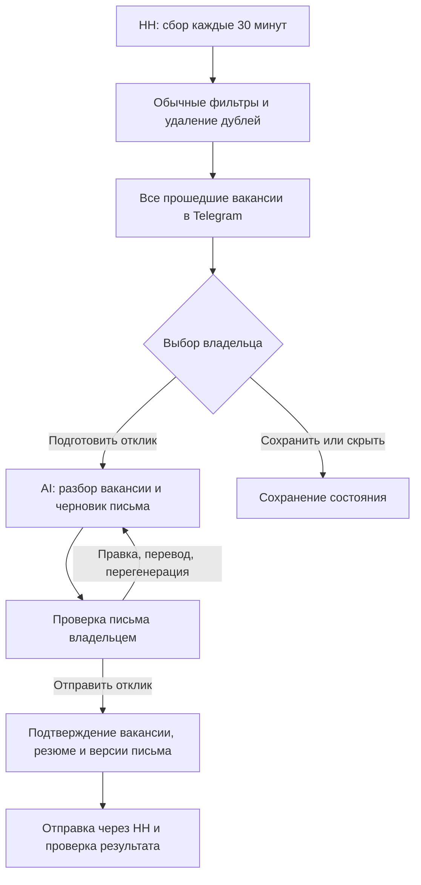

# Поиск работы в Jarvis

**Обновление 15 октября:** владелец сообщил о прекращении поддержки API
соискателя с 15 декабря 2025 и поручил найти другой канал. Предположение
об официальном API в разделах ниже больше не является действующим решением.
Пользовательские требования сохраняются. Владелец выбрал
[браузер DE с Playwright/Chromium](2026-10-15-job-search-without-api-options.md).
Публичная проба прошла; интеграция сбора и отправки через браузер продолжается.

Дата: 15 октября 2026 года. Статус: согласовано владельцем в текущем чате.
Реализация начата локально. Документ описывает согласованное поведение первой
версии; одобрение разрешает подготовку плана, но не push и выпуск.
Владелец сообщил, что API-ключ уже настроен. План использует существующую
конфигурацию OpenRouter без чтения и вывода значения; живой доступ ещё
не проверялся. Это не подтверждает подключение аккаунта HH.

Проверка при реализации 15 октября: в текущей официальной
[OpenAPI HH](https://api.hh.ru/openapi/specification/public) отсутствуют прежние
`POST /negotiations` соискателя и `/resumes/mine`. Старые Markdown-страницы
содержат ссылки на эти операции. Возможность отправки не подтверждена;
одного API-ключа может быть недостаточно. Владельцу сообщено расхождение,
решение о возможном альтернативном канале ожидается. Исходная цель отправки
сохраняется; ручной режим не объявляется её выполнением.

История обсуждения: [исходные договорённости](2026-10-14-job-search-initial-agreements.md).
После одобрения этот документ становится основным источником требований,
а исходные договорённости сохраняют историю без независимой копии спецификации.

## 1. Результат для владельца

Jarvis присылает все новые вакансии, прошедшие широкий поиск и обычные фильтры.
До отправки карточки модель не вызывается. Владелец выбирает интересную вакансию,
получает подготовленное моделью письмо, правит или перегенерирует его
и отдельно подтверждает отправку отклика с одним основным резюме HH.

## 2. Объём первой версии

Включены HH через официальный API, существующий бот Jarvis, PostgreSQL,
отдельный фоновый процесс на DE VPS, фильтры и настройки в Telegram,
AI по кнопке, редактирование писем и подтверждённая отправка доступных API-откликов.
Существующее меню Jarvis продолжает работать.

LinkedIn через почтовые уведомления — следующий отдельный этап. Первая версия
не читает LinkedIn, не автоматизирует его сайт и не отправляет туда отклики.
Массовые отклики без просмотра письма, самостоятельное изменение резюме,
автоматическая переписка с работодателем и обучение собственной модели
в эту версию не входят. Обычная веб-разработка без AI-задач не является
самостоятельной группой поиска.

## 3. Поиск и фильтры

Несколько запросов объединяются по идентификатору вакансии HH. Ищем по названию
и доступному тексту описания с русскими и английскими вариантами.

| Группа | Названия и признаки для запросов |
| --- | --- |
| Прикладной AI | AI Engineer/Engineering, Applied AI, Generative AI/GenAI, AI Developer, ИИ-инженер |
| LLM-разработка | LLM Engineer/Developer, AI Backend Developer, Software Engineer AI, LLM-разработчик |
| Промпты | Prompt Engineer/Engineering, промпт-инженер, промт-инженер, инженер промптов, Context Engineering |
| Агенты | AI Agent Engineer, Agentic AI, разработчик агентов и AI-ассистентов |
| Внедрение | AI Enablement, AI Implementation, AI Solutions/Solution Engineer, AI-консультант, внедрение ИИ/LLM |
| Автоматизация | AI Automation, автоматизация бизнес-процессов с AI, n8n/Make/no-code/low-code с AI-задачами |
| Аналитика | AI System Analyst, AI Business Analyst, аналитик AI-продуктов, системный/бизнес-аналитик AI/LLM |
| Знания | RAG Engineer/Developer, базы знаний для LLM, корпоративные AI-помощники |
| Диалоги | Conversational AI, Conversation Designer, разработчик/аналитик чат-ботов |
| Качество | AI Tester, AI QA Engineer, LLM QA/Evaluation, AI Quality, тестирование AI и чат-ботов |
| Начальные позиции | Junior AI/LLM/ML, младший AI-специалист, AI/ML Intern, стажёр ИИ |
| ML и исследования | Machine Learning/ML Engineer, NLP Engineer, Research Engineer/Scientist AI/ML, обучение и дообучение моделей |

Слова Python, AI, автоматизация или аналитик сами по себе недостаточны:
нужны название релевантной роли или явные задачи AI/ML, ботов, промптов,
интеграций либо соответствующей автоматизации. Никакой скрытой AI-оценки
и ограничения выдачи на основе процента соответствия нет.

Общие условия:

- Офис и гибрид — Москва. Удалёнка — любые города и страны при возможности
  работать из Москвы. Явное ограничение удалёнки другой страной исключает
  вакансию; неизвестные ограничения отмечаются как требующие уточнения.
- Любая занятость, включая оплачиваемую стажировку; любые формы оформления.
- Работа на русском и английском допустима. Конкретный уровень английского
  не приписывается владельцу.
- Нет фильтра по стажу, образованию, уровню junior/middle/senior,
  технологиям или необходимости учиться. Требования сохраняются в описании.
- Исключаются обязанности продаж и холодных звонков. Упоминание отдела продаж
  в задаче автоматизации само по себе не является исключением. Если смысл
  неоднозначен, вакансия сохраняется с пометкой.

### Оплата

Основной ориентир — 100 000 RUB в месяц на руки, верхнего ограничения нет.
Ищем сумму и в отдельных полях, и в описании/примечаниях. Выделяем валюту,
период, диапазон, налоговый статус, гарантированную часть и возможные премии.

| Данные | Действие |
| --- | --- |
| Подтверждённая месячная сумма на руки от 100 000 RUB | Показать |
| Диапазон допускает 100 000 RUB и выше, включая 80–150 тысяч | Показать; минимум не гарантирован |
| Только верхняя граница от 100 000 RUB | Показать; гарантированный доход неизвестен |
| Подтверждённая месячная сумма или вся вилка на руки ниже 100 000 RUB | Исключить |
| Суммы нет, налоги/период неясны, оплата до налогов без надёжного пересчёта | Показать; доход нужно уточнить |
| Поле и описание расходятся либо цель достижима только с премией | Показать; явно отметить условия |

Валютный порог пересчитывается из RUB по датированному курсу ЦБ.
При недоступном актуальном курсе показывается неопределённость;
устаревший курс не становится основанием жёсткого исключения.
Налоговый результат не выдумывается по стране работодателя. Для частичной
занятости автоматически не уменьшаем целевой месячный доход.

## 4. Сбор и доставка

Первый проход охватывает последние 14 дней. Затем проверка каждые 30 минут
с перекрытием интервалов, чтобы сбой или запоздалая публикация не теряли данные.
Начальная выдача идёт от новых вакансий к старым. Все прошедшие фильтры карточки
попадают в постоянную очередь; ограничения API и Telegram регулируют скорость,
но не создают пользовательский лимит количества. Тихих часов нет.

Ключ дедупликации — источник и ID вакансии для конкретного владельца.
Повторное совпадение запросов и перезапуск не создают новые задания доставки.
Изменение существующей вакансии обновляет запись, но не рассылает её повторно.
Изменение фильтров действует для последующих проходов; повторный просмотр
предыдущих 14 дней запускается отдельной командой с сохранением дедупликации.

Ошибки источника вызывают ограниченные повторы с задержкой и учётом его
ограничений. Постоянная ошибка подключения видна владельцу; успех не имитируется.
При неопределённом результате Telegram-доставки запись помечается отдельно:
Bot API не позволяет обещать строго однократную доставку при потере ответа.
Слепой повтор неизвестной отправки не является нормальным сценарием.

## 5. Telegram-сценарий

Предлагаемый вход: inline-пункт «Поиск работы» в главном экране владельца,
доступный в его личном чате. Постоянная нижняя клавиатура не меняется.
Точное размещение и кнопки этого раздела являются частью итогового согласования.

Карточка содержит должность, компанию, зарплату с оговорками, географию,
формат/занятость, краткие доступные условия, дату публикации и ссылку.
Неизвестные условия явно обозначаются. Блока «почему подходит» нет.

| Экран | Кнопки по строкам |
| --- | --- |
| Поиск работы | «Настройки», «Сохранённые»; «Отклики», «Проверить сейчас»; «Пауза поиска» / «Возобновить поиск», «Назад» |
| Карточка | «Открыть вакансию»; «Подготовить отклик»; «Сохранить», «Скрыть» |
| Черновик | «Перегенерировать», «Изменить»; «Перевести», «Отправить отклик»; «Отмена» |
| Подтверждение отправки | «Подтвердить отправку», «Назад к письму» |

«Сохранить» добавляет во внутренний список Jarvis, а «Скрыть» скрывает
внутри функции. Эти действия не меняют избранное или отклики HH.
Отказ от вакансии не меняет фильтры автоматически.
«Пауза поиска» останавливает сбор и новые карточки, но оставляет доступ
к сохранённым вакансиям и явным действиям над черновиками.
«Отмена» завершает текущую работу с письмом без отправки работодателю.

Правки и перевод принимаются в scoped guided input с понятным указанием,
какая вакансия и версия редактируются. Некорректный ввод допускает повтор;
истёкший ввод не применяется к другой вакансии. Обычный текст вне такого
состояния остаётся обычным диалогом Jarvis.

Настройки включают запросы/исключения, географию, зарплатные правила,
интервал/исторический период, модель, бюджетное уведомление и основной профиль.
Перед изменением фильтров показываются изменения и подтверждение владельца.
Показываются время последней проверки, состояние подключения и расходы.

## 6. Профиль и сопроводительное

Основа фактов — одно основное резюме HH, подтверждённые сведения владельца
и одобренные описания проектов. Прежний чат — источник примеров и стиля,
а не безусловное доказательство всех написанных моделью утверждений.
До реальной отправки владелец проверяет приватный профиль и основу письма.

Акцент — привычка улучшать рабочие и повседневные процессы автоматизацией
и AI. Письмо использует 2–3 релевантных подтверждённых примера, если они есть:
участие в корпоративном боте, Jarvis и другие автоматизации. Для каждого
понятны задача и участие владельца. Нет обязательной квоты на выдуманные кейсы.

Модель получает описание выбранной вакансии, профиль, одобренные примеры
и текущую правку. Она не получает всю историю общения или корпоративную
базу знаний. Краткий разбор помогает выбрать акценты письма; развёрнутый
отчёт об оценке не требуется для обычного сценария.

Язык выбирается по вакансии; при смешанном языке без явного требования —
русский. Перевод по запросу создаёт новую версию. Каждый черновик сохраняет
ссылки на версию профиля, вакансии и использованных примеров.
Неподтверждённые навыки, стаж, цифры эффекта и обучение не добавляются.
Разработка с AI не выдаётся за самостоятельное экспертное владение всем стеком.

Перегенерация, правка и перевод создают новую версию. Одновременное повторное
нажатие не запускает несколько одинаковых генераций. При ошибке модели
предыдущий черновик сохраняется, отправка работодателю не выполняется.

## 7. Подключение HH и отправка

Используется официальный путь авторизации соискателя без сбора пароля HH.
Владелец выбирает одно основное резюме; Jarvis не редактирует его автоматически.
Секреты подключения хранятся приватно вне Git, журналов и callback.

«Подготовить отклик» только создаёт черновик. «Отправить отклик» показывает
компанию, вакансию, основное резюме и полный текущий текст. Отдельная кнопка
подтверждает именно этот набор в том же личном Telegram-чате.
Подтверждение имеет срок действия 10 минут, одноразовое и привязано к владельцу,
conversation/chat/channel, версии письма, резюме и вакансии. Любая правка
или смена резюме аннулирует старое подтверждение.

Перед отправкой проверяются подключение, доступность вакансии/резюме,
отсутствие уже отправленного отклика и актуальность подтверждения.
Если вакансия изменилась после подготовки письма, владелец получает
обновлённые условия и готовит/подтверждает письмо заново.

Намерение отправки и исходный ID сохраняются до внешнего запроса.
Статусы различают черновик, ожидание подтверждения, отправку, успех,
определённый отказ и неизвестный результат. При тайм-ауте сначала проверяется
состояние исходного отклика. Пока результат неизвестен, новая отправка
блокируется; один локальный ID не выдаётся за гарантию идемпотентности HH.

Автоматически доступны только операции, которые реально разрешены API
приложению, аккаунту и вакансии. Внешняя анкета, дополнительные обязательные
шаги или ограничения API переводят отклик в ручной режим: ссылка и готовое
письмо, без обхода ограничений и без сообщения «отправлено».
Авторизация и реальная возможность API-отклика являются проверяемым условием
готовности, а не уже подтверждённой возможностью текущего окружения.

## 8. Модель и расходы

Отдельная модель и настройки OpenRouter для функции. Кандидаты — недорогие
DeepSeek и Qwen; конкретные model ID и провайдер выбираются перед включением
на одинаковом наборе реальных вакансий и одобренных фактов. Сначала оцениваются
точность фактов, соответствие задачам, русский/английский и соблюдение правок,
затем стоимость и задержка. Тарифы прежних расчётов не фиксируют выбор.

Приёмочное сравнение: 10–15 разнородных вакансий, оба языка, несколько
перегенераций и правок. Владелец просматривает письма. Выдуманные достижения
являются основанием отклонить вариант модели/промпта и повторить проверку.

3 USD — месячный порог уведомления, не жёсткий лимит. Предлагаемое правило
после уведомления: работа продолжается. Владелец может изменить порог или
приостановить AI. Это правило явно включено в итоговое согласование.
Месяц календарный по Europe/Moscow, расходы в USD, только для поиска работы.
Уведомление одно на пересечение порога за месяц, без спама при каждом запросе.

Учитываются генерации, правки, переводы, сравнение моделей и оплаченные повторы.
Сбор и карточки AI-расходов не создают. По возможности берётся фактическая
стоимость ответа; неизвестная стоимость помечается и сверяется, не считается
нулевой. Комиссия пополнения и содержание VPS не смешиваются с API-расходами.
Повторы модели ограничены, бесконечных циклов генерации нет. Смена на более
дорогую модель без явной настройки владельца не допускается.

## 9. Компоненты и данные

| Компонент | Ответственность и граница |
| --- | --- |
| Ядро поиска работы | Правила фильтрации, состояния карточек/писем/откликов; не зависит от Telegram SDK |
| Адаптер HH | Получение, авторизация и разрешённые отклики; переводит внешние данные в внутренний контракт |
| Фоновый процесс DE | Расписание, сбор и ограниченные фоновые задания; не получает Telegram updates |
| Telegram-адаптер Jarvis | Проверяет владельца, отображает состояния, принимает подтверждения и правки |
| Адаптер модели | Использует общий транспорт OpenRouter с отдельными настройками и учётом расходов |
| PostgreSQL-репозитории | Приватные профили, поиски, вакансии, совпадения, черновики, подтверждения, операции, расходы и очередь |

Вакансия нормализуется отдельно от пользовательских состояний. Профиль,
подключение, сохранённое, скрытое, письмо и отклик всегда имеют владельца.
Задания получают ID и блокировки, чтобы перезапуск или два исполнителя
не порождали параллельные мутации. Устойчивость обеспечивается PostgreSQL;
новая очередь или production-зависимость не добавляется без согласования.

Изменения БД — forward-only migrations. Новые guided-input kinds одновременно
добавляются в закрытую allowlist и PostgreSQL CHECK. Конкретные имена таблиц,
callback-грамматика и размещение кода определяются планом в существующих границах.
Сервер не получает Docker socket, sudo или произвольное исполнение shell моделью.
Windows-клиент и VPN не требуют изменений для первой версии.

## 10. Доверие и эксплуатация

Доступ проверяется по серверной идентичности на каждом действии. Кнопка
не является полномочием. Callback не длиннее 64 UTF-8 байт и не содержит
текста писем, секретов или локальных путей. Короткие ID разрешаются на сервере.

Вакансии, резюме и примеры — недоверенные данные. Их инструкции не могут
разрешать отправку, менять профиль или отменять подтверждение. Размеры входа
ограничиваются до буферизации; текст очищается для безопасной Telegram-доставки.
Приватный профиль и письма остаются в приватном хранилище, не в Git.
Диагностика использует закрытые коды без текста вакансий, резюме,
callback, писем, credentials и произвольных исключений.

Новый домен не ломает обычные диалоги и существующие подтверждения Jarvis.
До правки Telegram-пути обязателен change notice по
[архитектуре](../../telegram-button-architecture.md), с затронутым маршрутом,
файлами, проверками и практической приёмкой. Одобрение этой спецификации
охватывает описанный пользовательский сценарий; расширение границ требует
отдельного согласования. Действующий
[контракт меню](../../telegram-menu-contract.md) обновляется при реализации,
а не заранее как будто функция уже выпущена.

## 11. Проверки готовности

- Фильтры: все группы, русский/английский, обычные упоминания AI,
  стаж без отсева, география и неопределённые условия.
- Зарплата: поля и описание, диапазоны, налоги, премии, валюты,
  недоступный курс и конфликт источников. Нет AI-вызовов при сборе.
- Сбор: 14 дней, страницы выдачи, перекрытие, ограничения API,
  рестарт и дедупликация, очередь после ошибок Telegram.
- Настоящие Telegram handlers: владелец/чужой пользователь и чат,
  malformed/replayed callbacks, expiry, invalid retry, single consumption,
  правка/перевод и устаревшие подтверждения. Без подмены guided-input begin.
- Реальный PostgreSQL: миграции, CHECK, конкурентные нажатия,
  фиксация операции перед отправкой, восстановление неизвестного результата.
- Подключение HH: отозванный доступ, недоступное резюме, уже отправленный
  отклик, внешняя анкета, определённая ошибка и тайм-аут без слепого повтора.
- Модель: отсутствие ключа, сетевые ошибки, prompt injection, выдуманные факты,
  сохранение старого черновика, учёт расходов и одно бюджетное уведомление.
- Telegram regression gate из menu contract и полный `server/npm test`
  перед развёртыванием. Реальные нажатия и API-проверки отмечаются отдельно.

Реальный отклик для приёмки отправляется только на выбранную владельцем
вакансию после просмотра и подтверждения текста. Синтетический тест не создаёт
отклик работодателю и не считается реальной API-приёмкой.

## 12. Переход к реализации и выпуск

После одобрения документа готовится отдельный план реализации. Перед кодом
повторяются аудит веток/worktrees/PR и сверка локальных/GitHub/VPS-исходников
и работающих компонентов. Проверка от 14 октября не заменяет новую сверку.
Настройка HH-приложения, разрешённого доступа, основного резюме и приватного
профиля выполняется как явный этап подключения без записи секретов в документы.

Сначала проверяются сбор и карточки, затем черновики и правки, затем отправка
и восстановление неизвестных операций. Самостоятельный сбор не зависит
от доступности AI. Непроверенная отправка не объявляется готовой.

Push, PR и развёртывание требуют отдельного поручения по
[release-workflow](../../release-workflow.md). При выпуске меняющихся компонентов
обновляются нужный server runtime и фоновый процесс DE, проверяется health;
оба VPS-исходника синхронизируются по правилам проекта. Desktop EXE
не пересобирается, если его код и ресурсы не менялись.
