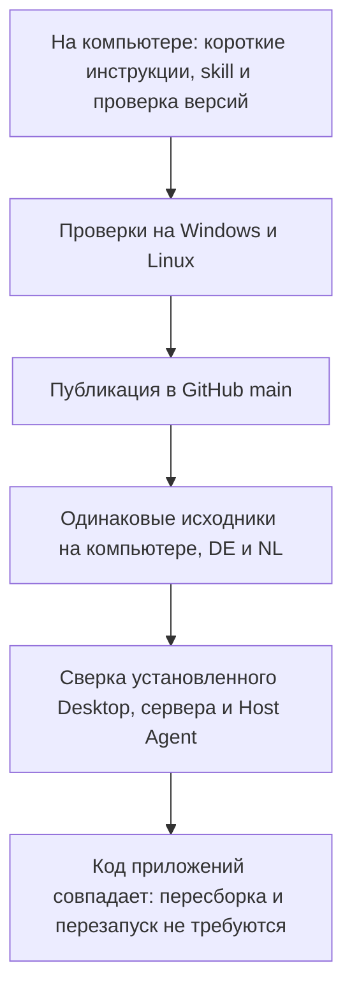

# Единый порядок выпуска и короткий контекст агентов

9 октября 2026 года обновили правила выпуска Jarvis и добавили проверку
синхронизации. Теперь у агентов есть общий порядок: проверить незавершённую
работу, протестировать изменения, опубликовать их в GitHub, обновить оба VPS
и убедиться, что установленный код соответствует принятой версии.

## Что изменилось для владельца

- Инструкции стали короче. Подробности и история сохранены в отдельных документах.
- Skill `jarvis-release` направляет агентов к одним и тем же правилам выпуска.
- Одна команда сверяет GitHub, компьютер, два VPS и установленный Windows-клиент.
- Перед новой задачей проверяются другие ветки и рабочие папки, чтобы сохранить
  незавершённые изменения.

Синхронизацию выполняет агент во время порученного выпуска. Автоматическое
обновление по каждому изменению на GitHub пока не включено. Проверочная команда
показывает расхождения; установка обновлений выполняется отдельным шагом.

## Как прошёл этот выпуск

Это выпуск документации и инструмента проверки. Номер Windows-приложения
остался 1.0.2. Работающий сервер остался на релизе `52d085a`: его код и входные
файлы сборки соответствовали опубликованной версии. VPN-ключи и данные
пользователей не менялись.

Постоянные схемы синхронизации и простое объяснение находятся в
[руководстве по выпуску](../release-workflow.md#как-синхронизация-работает-сейчас).
Ниже сохранены подробности и результаты проверок этого выпуска.

## Что вошло и как проверено

`AGENTS.md` сокращён с 638 до 155 строк. `docs/README.md` сокращён с 493
до 73 строк перед добавлением этой записи. CLAUDE/gemini содержат короткие
ссылки на общий контекст. Подробности перенесены в `docs/runtime-context.md`
и `docs/verification.md`; прежние полные редакции сохранены в `docs/history/`.
Обязательные Telegram, секреты, origin-bound confirmation, original-ID recovery,
production mounts и Desktop-правила сохранены.

[Руководство](../release-workflow.md) описывает проверку веток/worktrees/PR/stash,
объединение и публикацию в `main`, синхронизацию двух source checkout,
обновление нужных компонентов и распределение MD-файлов по темам. В нём есть
Mermaid-схема. Чужая работа изучается и сохраняется; автоматических merge,
удаления веток, reset/clean и deployment по каждому push нет.

Skill `jarvis-release` хранится в `.agents/skills/jarvis-release/` и установлен
в локальный каталог Codex skills. Оба экземпляра проверены validator; локальная
копия соответствует отслеживаемой версии. Другие агенты следуют AGENTS и
руководству даже без механизма skills.

`deploy/scripts/release-status.py` читает Git и установленный код. `--fetch`
обновляет tracking refs, `--vps` проверяет оба SSH-хоста, `--desktop-app` проверяет
установленный Windows-клиент. `--check` возвращает ошибку при незавершённой
синхронизации, ветках/stash/worktrees для разбора, различиях или недоступной
проверке. Проверяется native Electron, bundled Node, Desktop-код/ресурсы,
server-код/зависимости/входные файлы сборки и Host Agent. Secret files не читаются.

14 fixture-тестов прошли на Windows и на обеих Linux-нодах. Они проверяют
сохранение чужой ветки, remote branch, грязного worktree и stash; выявление
отставшего VPS, отсутствующего Desktop, отличающегося native code и неверного
origin без вывода его secret-bearing URL. Два Telegram documentation contract
теста, skill validation, ссылки и `git diff --check` прошли.

Реальная итоговая сверка после публикации implementation commit
`5a1a2d0b90e82c253fb7f219009ad15984387f1e` завершилась без issues:

| Компонент | Результат |
| --- | --- |
| GitHub, Windows, DE source, NL source | Одинаковая опубликованная `main`, чистые source checkout |
| Установленный Desktop 1.0.2 | 140 файлов соответствуют принятому коду; manifest, native Electron 42.11.9 и bundled Node совпадают |
| Server DE | 256 файлов соответствуют принятой версии; healthy; старый release `52d085a` имеет те же runtime/build inputs |
| Host Agent | По 16 Python-модулей на DE/NL соответствуют принятой версии |
| VPN-службы и peer timers | Active на обеих нодах |

В этом выпуске менялись инструкции и проверочный инструмент. Приложения не
пересобирались и не перезапускались. VPN-ключи, subscription tokens, окружение,
порты, контейнеры и пользовательские данные не менялись.
Совпадение версии не заменяет реальный Telegram, microphone или VPN traffic
acceptance. Результат Hysteria hopping остаётся в предыдущей
[VPN-записи](2026-10-08-vpn-probe-resilience.md).
